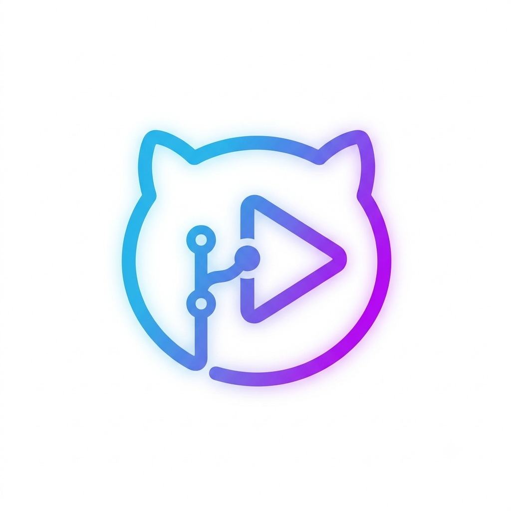
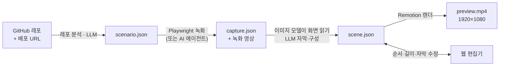

<div align="center">



# DemoDay

**시연을 찍지 마세요, 레포를 넣으세요.**

GitHub 레포와 배포 URL만 넣으면 실제 서비스 화면을 녹화해<br>
발표용 데모 영상(MP4, 1920×1080)을 만들어 주는 영상 스튜디오

[](https://demoday-topaz.vercel.app/)


[사용법](#사용법) · [주요 기능](#주요-기능) · [동작 방식](#동작-방식) · [기술 스택](#기술-스택) · [직접 실행하기](#직접-실행하기)

<sub>2026 경북대학교 컴퓨터학부 해커톤</sub>

</div>

---

캡스톤·종합설계 팀은 발표 직전마다 데모 영상을 찍고, 자르고, 자막을 붙이느라 시간을 씁니다. DemoDay는 레포를 읽어 **무엇을 어떤 순서로 보여줄지** 정하고, 배포된 서비스를 **실제로 써 보며 녹화한 뒤**, 화면에 맞는 자막과 모션 그래픽을 입혀 바로 발표에 쓸 수 있는 영상을 만듭니다.

> [!NOTE]
> LLM은 영상을 직접 만들지 않습니다. 장면 구성(JSON)만 만들고, 렌더러가 실제 녹화 화면을 그대로 그립니다. 그래서 실제 서비스와 다른 "가짜 데모"가 나오지 않습니다.

## 사용법

**[demoday-topaz.vercel.app](https://demoday-topaz.vercel.app/)** 에서 바로 써 볼 수 있어요. 설치는 필요 없습니다.

1. **프로젝트 입력** — GitHub 저장소 URL과 배포 URL을 넣고 최대 영상 길이를 고릅니다. 처음이라면 **예시로 채우기**를 눌러 보세요.
   - 로그인이 필요한 서비스라면 **테스트 계정 및 제작 요청 (선택)** 을 열어 테스트 계정을 넣습니다. 로그인 값은 영상·로그 어디에도 남지 않아요.
   - 같은 곳에 "검색 기능을 먼저 보여주세요", "잔잔한 분위기로"처럼 **영상에 바라는 점**을 적을 수 있어요. 자막 말투·강조할 기능·배경음악 분위기에 반영돼요.
2. **시나리오 확인** — DemoDay가 레포를 분석해 만든 **촬영 순서**가 나옵니다. 단계를 길게 눌러 끌어 순서를 바꾸거나 빼고 **영상 만들기**를 누릅니다. 새로고침해도 고친 순서는 남아 있어요.
3. **영상 미리보기** — 녹화 → 자막 → 렌더링이 진행됩니다(보통 1~3분). 완성되면 바로 재생하고 **MP4로 다운로드**할 수 있어요.
4. **장면 수정** — 장면 순서·길이·자막을 고치고 **저장하고 다시 렌더링**을 누르면 수정본이 나옵니다.

> [!TIP]
> 영상 길이는 내용에 맞춰 정해지고, 고른 시간은 **최대 길이**로만 쓰입니다. 짧은 서비스를 억지로 늘리지 않아요.

## 주요 기능

| | |
|---|---|
| **레포 분석 → 시나리오** | 라우트·버튼·입력칸·README를 읽어 **핵심 기능 3~5개** 위주로 시연 순서를 짭니다. 단계 수는 영상 길이에 비례해요. React Router · Next.js · Vue Router · Nuxt · SvelteKit · Flutter web 지원 |
| **실제 화면 녹화** | 헤드리스 브라우저가 배포 URL에서 마우스를 움직여 클릭·입력·스크롤하며 녹화합니다. 로딩 중·로그인 화면은 자동으로 거르고, 배포 사이트가 죽어 있으면 오류 페이지 대신 경고를 띄워요 |
| **에이전트 녹화 모드** | AI가 화면을 직접 보고 다음에 누를 곳을 골라 서비스 흐름을 따라갑니다. 코드 분석으로 찾은 단계가 적으면 자동으로 켜지고, 고른 동작은 저장해 두고 다음부터 그대로 재생해요 |
| **화면을 읽는 자막** | 이미지 모델이 녹화 화면을 읽고, 실제로 보이는 내용으로 해요체 자막과 강조어를 씁니다 |
| **이야기가 있는 구성** | 문제 상황 → "하지만 {서비스}를 사용한다면?" → 실제 화면 시연 → **[로고][서비스 이름] "이제, ~하세요"** 엔딩. 문제 상황은 상황마다 다른 가상 화면 모션 그래픽(캘린더 충돌·엑셀 수작업·청구서·오류 페이지 등 11가지)으로 보여 줘요. 로고와 이름은 배포 사이트에서 가져옵니다 |
| **화면에 맞는 연출** | 클릭한 곳은 클로즈업, 핵심 영역은 3D 기울기, 둘러보는 화면은 넓게 훑기. 단어별로 올라오는 자막과 움직이는 배경 |
| **분위기에 맞는 배경음악** | 프롬프트의 분위기(밝은·차분한·신나는·감성적인·테크)로 고른 곡을 깔아요. 곡은 코드로 합성해 저작권 걱정이 없어요 |
| **웹에서 수정·재렌더** | 시나리오 순서, 장면 길이·자막을 고쳐 다시 렌더링 |

## 동작 방식



단계 사이의 데이터 형식은 [`contracts/*.schema.json`](contracts/)이 정합니다. 각 단계는 실패해도 멈추지 않고(대체 화면·규칙 기반 기본값) 영상은 끝까지 나오도록 만들었습니다.

## 기술 스택

| 영역 | 기술 |
|---|---|
| **웹** (`web/`) | Next.js 16 · React 19 · Tailwind CSS 4 · TypeScript |
| **API · 분석** (`backend/`) | Python 3.12 · FastAPI · Pydantic · httpx · Pillow |
| **녹화** (`capture/`) | Playwright (Chromium) · tsx |
| **렌더** (`render/`) | Remotion 4 · React · Pretendard 글꼴 · 코드 합성 배경음악(`scripts/make-music.mjs`) |
| **AI** | BAZE API 게이트웨이 — Claude Sonnet 5.5(시나리오·자막 글쓰기), Claude Haiku 5.5(화면 읽기·에이전트). 예비 Groq · Anthropic API |
| **계약** (`contracts/`) | JSON Schema → Python(pydantic)·TypeScript 타입 자동 생성 |
| **도구** | pnpm 워크스페이스 · uv · Ruff · pytest · Make |
| **배포** | 웹 Vercel · API 자체 서버 |

```
contracts/   JSON Schema 3개 + fixtures  (팀 계약 — 합의 없이 수정 금지)
backend/     FastAPI, 레포 분석, LLM(시나리오·자막·화면 읽기·에이전트)
capture/     Playwright 녹화
render/      Remotion 장면·렌더
web/         Next.js 웹(입력·시나리오 확인·미리보기·장면 수정)
scripts/     계약 검증, 타입 생성, e2e
```

## 직접 실행하기

필요: Node 20+ · [pnpm](https://pnpm.io/) · [uv](https://docs.astral.sh/uv/) · make

```bash
git clone https://github.com/1111-dh/DemoDay.git && cd DemoDay
make setup        # 의존성, Playwright 크로미움, git 훅 설치, .env 생성
make check        # 통과하면 준비 완료

make dev-api      # API  http://localhost:8000
make dev-web      # 웹   http://localhost:3000

# 웹 없이 한 번에 영상 만들기
make e2e REPO=https://github.com/nuxt/movies URL=https://movies.nuxt.space
```

> [!NOTE]
> LLM 키가 없어도 규칙 기반 기본값으로 영상은 나옵니다(자막이 단순해져요).

<details>
<summary><b>환경변수 (<code>.env</code>)</b></summary>

| 이름 | 필수 | 설명 |
|---|---|---|
| `LLM_PROVIDER` | 권장 | `baze`(기본 추천) · `groq` · `anthropic` 중 하나 |
| `BAZE_API_KEY` | `baze`일 때 | BAZE API 게이트웨이 키. 기본 모델은 글쓰기 Claude Sonnet 5.5, 화면 읽기·에이전트 Claude Haiku 5.5 (`BAZE_MODEL`, `BAZE_VISION_MODEL`, `BAZE_AGENT_MODEL`로 변경) |
| `GROQ_API_KEY` | 선택 | `baze`가 크레딧·장애로 실패하면 예비로 사용 |
| `ANTHROPIC_API_KEY` | `anthropic`일 때 | Anthropic API 키 |
| `GITHUB_TOKEN` | 권장 | 없으면 GitHub API가 시간당 60회로 제한돼 분석이 실패할 수 있어요 |
| `CAPTURE_MODE` | 선택 | 비우면 코드 분석이 빈약할 때만 에이전트 녹화, `agent`면 항상, `plan`이면 끔(에이전트는 느리고 결과가 매번 달라요) |
| `DEMODAY_API_URL` | 웹 배포 | 웹 서버가 API로 요청을 넘길 주소(기본 `http://127.0.0.1:8000`) |

</details>

<details>
<summary><b>시연 레포 미리 준비</b></summary>

```bash
make warm          # backend/samples.json의 레포를 미리 분석해 캐시
make warm AGENT=1  # 에이전트로 한 번 녹화해 고른 동작을 캐시(시연 때는 그대로 재생)
# 웹에서 고를 수 있는 60·90·180초 길이 모두의 시나리오를 채워요
```

웹의 **예시로 채우기**가 `backend/samples.json`을 읽습니다. 같은 레포·URL·프롬프트로 요청하면 캐시에서 바로 나와요.

</details>

<details>
<summary><b>배포</b></summary>

> [!IMPORTANT]
> API 하나가 분석·녹화(크로미움)·렌더(Remotion)를 모두 돌립니다. 메모리 **2GB 이상** 서버가 필요하고, 512MB 무료 컨테이너에서는 렌더 중에 멈춰요.

1. 서버에서 `make setup` 후 `.env`를 채웁니다.
2. API 실행: `cd backend && uv run uvicorn app.main:app --host 0.0.0.0 --port 8000`
3. 웹(`web/`)은 배포 환경변수에 `DEMODAY_API_URL=<API 주소>`만 넣으면 됩니다. 웹 서버가 `/api/runs/*`를 API로 넘겨 CORS 설정이 필요 없어요.

**현재 운영 구성**

| | 위치 | 비고 |
|---|---|---|
| 웹 | Vercel — [demoday-topaz.vercel.app](https://demoday-topaz.vercel.app/) | Production 환경변수 `DEMODAY_API_URL`로 API에 연결 |
| API | Oracle Cloud 서버 (상시 실행) | 분석·녹화·렌더 전부. 시연 레포 캐시(`make warm AGENT=1`)를 채워 둠 |

처음에는 노트북에서 API를 돌리고 [Cloudflare 무료 터널](https://developers.cloudflare.com/cloudflare-one/connections/connect-networks/do-more-with-tunnels/trycloudflare/)로 공개했지만, 노트북이 꺼지면 끊겨서 Oracle 서버로 옮겼어요([#69](https://github.com/1111-dh/DemoDay/issues/69)).

> [!NOTE]
> 자동 배포는 없습니다. main에 머지된 변경은 서버에서 `git pull` 후 API를 다시 시작해야 반영돼요(웹은 Vercel이 main 기준으로 배포).

</details>

<details>
<summary><b>자주 쓰는 명령</b></summary>

`make help`로 전체 목록을 볼 수 있어요.

| 명령 | 설명 |
|---|---|
| `make check` | 계약 + 타입 + lint + test 전부 (커밋할 때 자동 실행) |
| `make e2e REPO=… URL=… [PROMPT=…]` | 전체 파이프라인. 어느 단계에서 깨지는지 출력 |
| `make warm [AGENT=1]` | 시연 레포 캐시 |
| `make studio` | Remotion 장면 미리보기 (fixture) |
| `make e2e-render` | fixture → `runs/fixture/preview.mp4` |
| `make e2e-web-video` | 웹에서 영상 제작·다운로드·자막 수정·재렌더 회귀 테스트 (API 키 불필요) |
| `make gen` | 스키마 변경 후 Python/TS 타입 재생성 |

`make e2e-web-video`는 임시 포트에서 웹과 API를 띄워 로컬 예제 페이지로 영상을 만들고, 두 MP4의 같은 시점 프레임에서 자막 글자 모양을 비교합니다. 결과와 실패 시 로그(`api.log`, `web.log`, `failure.png`)는 `runs/video-regression-*/`에 남아요.

</details>

<details>
<summary><b>AI 에이전트 하네스 (팀 개발 방식)</b></summary>

팀원 셋이 Claude Code와 Codex로 나눠 개발했고, 두 에이전트가 같은 규칙(`AGENTS.md`)을 읽습니다.

| | Claude Code | Codex |
|---|---|---|
| 규칙 | `CLAUDE.md` → `AGENTS.md` | `AGENTS.md` (루트 + 폴더별) |
| 계약 파일 보호 | 편집 시점에 훅이 차단 | 커밋 시점에 pre-commit이 차단 |
| 수정 직후 검사 | 훅 (ruff / tsc / 스키마) | `make check`를 직접 돌리게 AGENTS.md에 명시 |
| 완료 전 검사 | Stop 훅이 `make check` 강제 | pre-commit이 `make check` 강제 |
| 슬래시 명령 | `/e2e`, `/new-scene`, `/contract-change` | AGENTS.md에 같은 절차 |

**계약 변경 절차:** 팀 합의 → `DEMODAY_CONTRACT_CHANGE=1 claude`(Codex는 직접 수정) → 스키마 수정 → `make gen` → fixtures 갱신 → `DEMODAY_CONTRACT_CHANGE=1 git commit`

</details>

## 더 보기

- 기획안: [`docs/기획안.md`](docs/기획안.md)
- 폴더별 규칙: [`backend/AGENTS.md`](backend/AGENTS.md) · [`capture/AGENTS.md`](capture/AGENTS.md) · [`render/AGENTS.md`](render/AGENTS.md)
